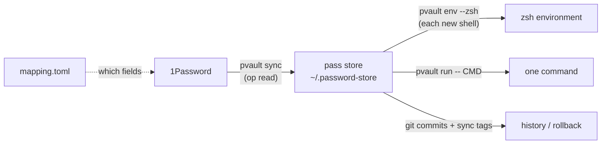

# pvault

pvault copies secrets from 1Password into [pass](https://www.passwordstore.org/)
and puts them in your zsh environment. 1Password stays the source of truth; pass
gives you a fast, offline, git-versioned local copy that shells and scripts can read
without a 1Password prompt each time.



macOS only. zsh only.

## Quick start

```sh
git clone git@github.com:andytavares/passvault.git
cd passvault
./install.sh                  # builds ~/.local/bin/pvault, then runs pvault setup
pvault mapping add --pass github-token --ref "op://Private/GitHub/token" --env GITHUB_TOKEN
pvault sync                   # copies the secret into pass
exec zsh                      # new shell: GITHUB_TOKEN is set
```

Run plain `pvault` in a terminal to open the interactive TUI.

## Documentation

| Read this | For |
|---|---|
| [Installation and management](docs/install.md) | Requirements, install, what setup changes, upgrade, uninstall, doctor |
| [Usage guide](docs/usage.md) | Every day-to-day task: adding secrets, syncing, conflicts, shell use, history, rollback, scripting |
| [The mapping file](docs/mapping.md) | Every field of `mapping.toml`, scopes, secret references |
| [Command reference](docs/commands.md) | Every command, flag, output line and exit code |
| [TUI](docs/tui.md) | The interactive interface and its keys |
| [How it works](docs/how-it-works.md) | Files, data flow, security model |
| [Troubleshooting](docs/troubleshooting.md) | Error messages and fixes |
| [Development](docs/development.md) | Building, testing, project layout |
