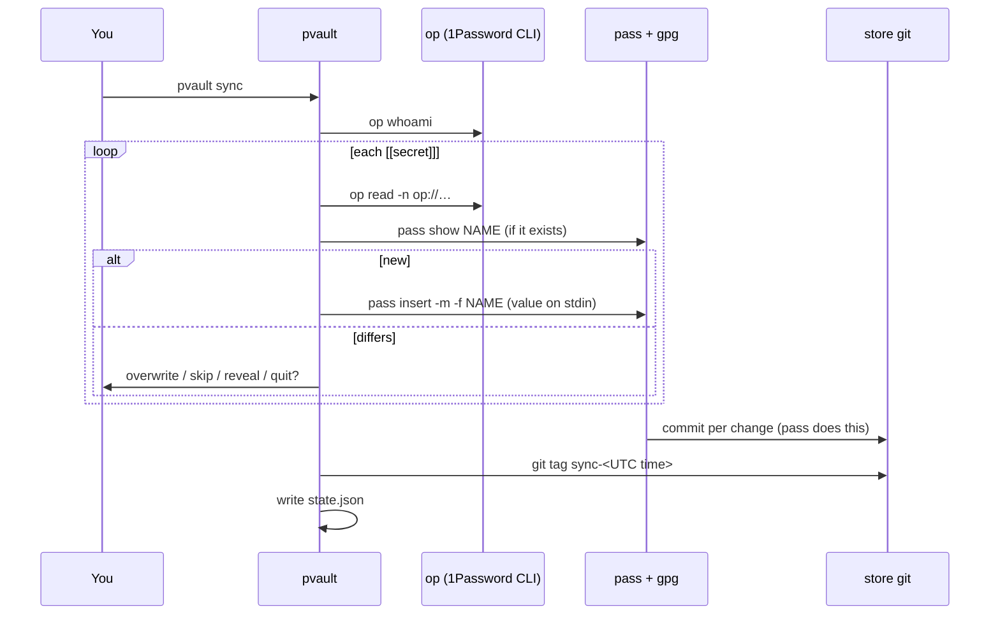

# How it works

## Data flow



## Files

| Path | Written by | Holds | Secrets? |
|---|---|---|---|
| `~/.config/pvault/mapping.toml` | you, `mapping init/add`, setup | which 1Password fields go where | no, references only |
| `~/.local/state/pvault/state.json` | sync | per entry: last write time and sync tag | no |
| `~/.local/state/pvault/manifest.json` | setup | packages installed, key created, files edited, source clone, schema version | no |
| `~/.password-store/**.gpg` | pass | the values, encrypted to your GPG key | yes, encrypted |
| `~/.zshrc` (managed block) | setup | one line that evaluates `pvault env --zsh` | no |
| `~/.gnupg/gpg-agent.conf` (managed block) | setup | `pinentry-program …/pinentry-mac` | no |
| `~/.zshrc.pvault-<time>` | setup | your `~/.zshrc` before pvault first edited it | no |
| `~/.local/bin/pvault` | install.sh, upgrade | the binary | no |

Config, state and manifest files are mode `0600` in `0700` directories.

### Managed blocks

pvault edits shared files only between these markers and leaves every other byte as
it was:

```
# >>> pvault >>>
…
# <<< pvault <<<
```

Do not edit inside the markers; setup rewrites that part. A begin marker without an
end marker (or the reverse) makes setup stop with an error instead of guessing.

## Security model

What pvault does to keep values out of places they leak from:

- **Never in argv.** Values go to `pass insert` on stdin and come from `op read` on
  stdout. `ps` never shows them.
- **Never on disk outside pass.** `state.json`, the manifest, reports and error
  messages hold names, lengths, times and tags only. `op` errors include stderr only,
  never partial stdout.
- **Shown only on request.** Conflicts show lengths. Values appear only after `v` (CLI
  and TUI) or `r` (TUI), and the TUI hides them again after 10 seconds or on any
  move. Buffers are zeroed after use.
- **No silent overwrite.** A differing pass value needs `o` per entry.
- **Typed confirmation** for destructive TUI actions (delete, rollback) and for
  `uninstall --purge-vault`.

What pvault cannot protect:

- **`global` scope** exports the value to every process started from your shell.
  `pvault doctor` warns about each one. Prefer `scope = "command"` or `pvault run`.
- **Command wrappers and `pvault run`** put the value in that child's environment,
  readable by that process and anything it starts.
- **The pass store** is as safe as your GPG key and its passphrase. pvault does not
  push the store's git repo anywhere; if you add a remote yourself, you are
  publishing ciphertext and entry names.
- **`pass show -c`** leaves the value on the clipboard for 45 seconds.

## Versioning and migrations

- `mapping.toml` has `version = 1`. A newer version than the binary supports fails
  validation with a hint to run `pvault upgrade`.
- The manifest has `schema_version`. `pvault setup` (and so `upgrade`) runs any
  migrations above the stored version before the setup steps. There are none yet.

The original design notes, with mockups, are in [design.html](design.html).
